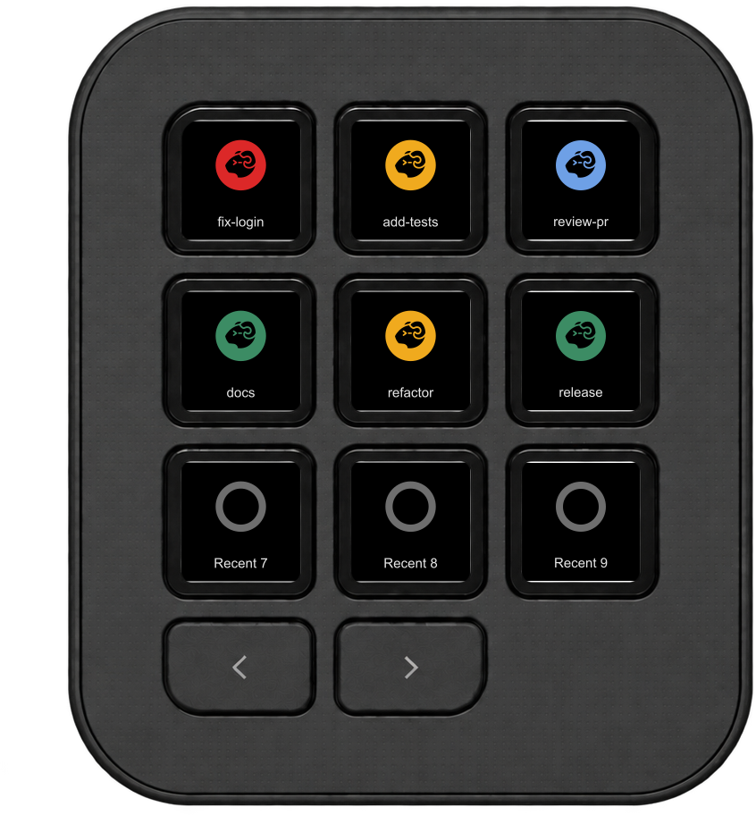
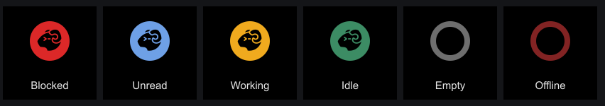
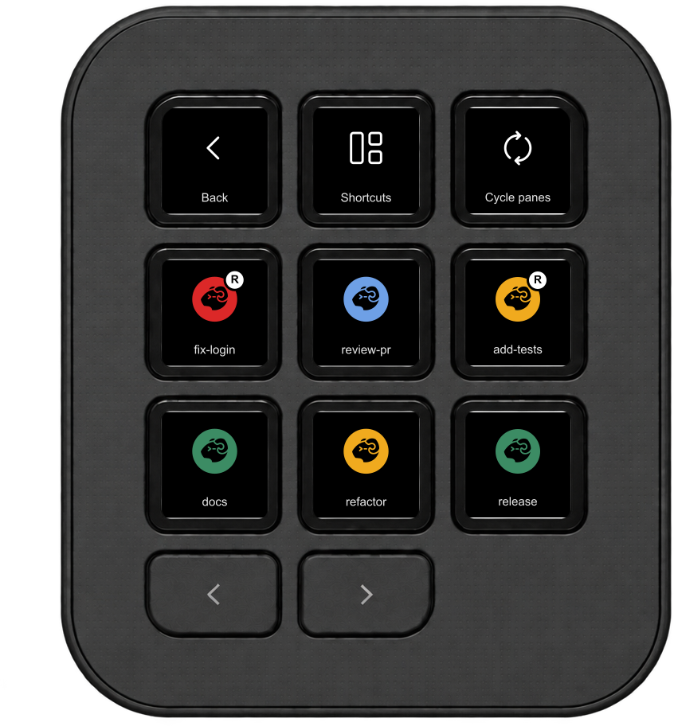
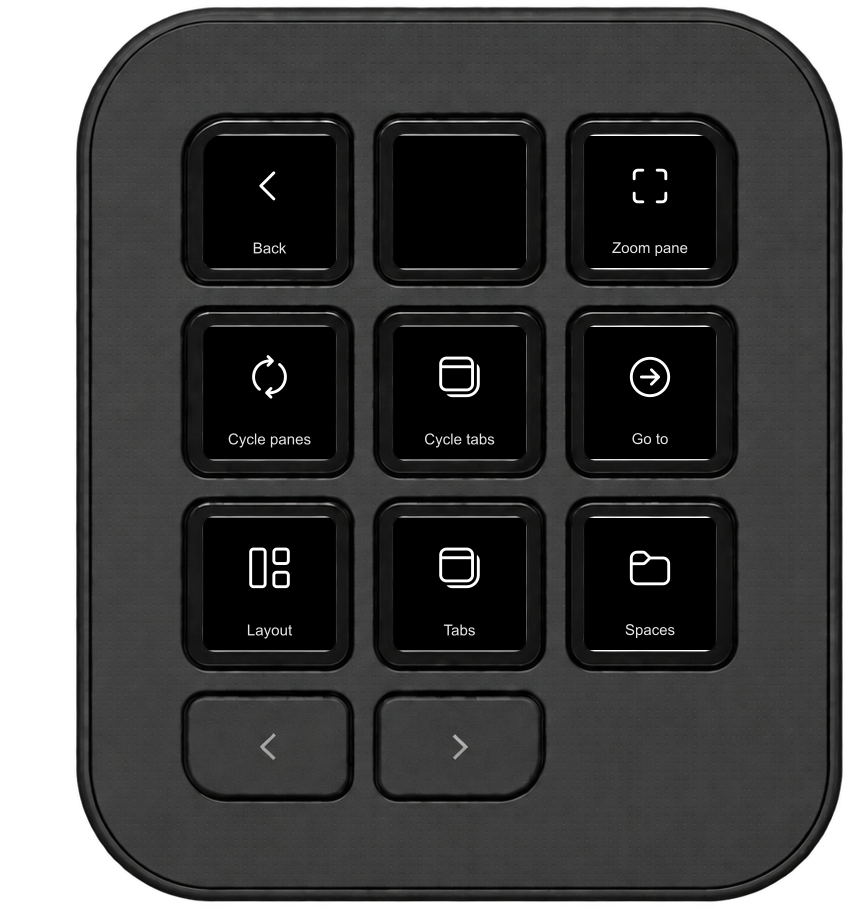
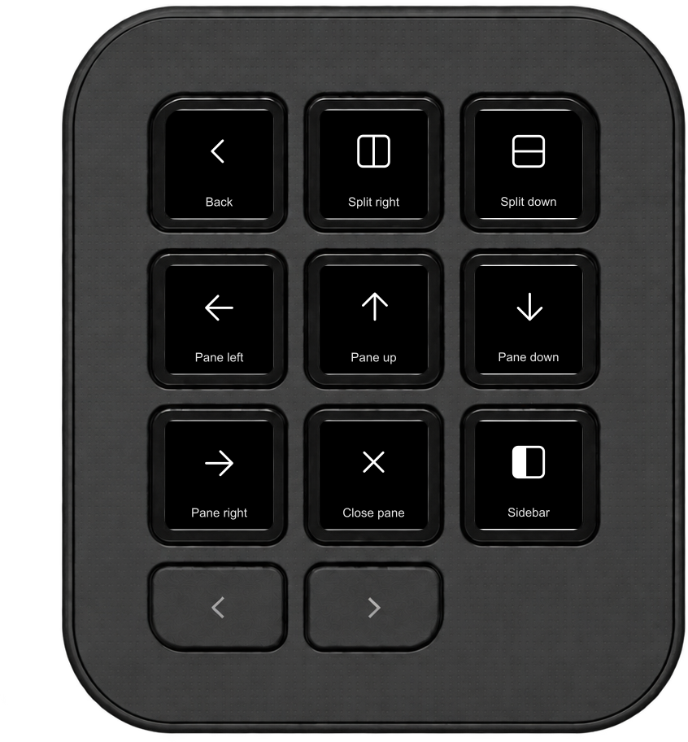

# Herdr App Keypad

Monitor **local and remote agents together** on the Logitech MX Creative Keypad
with this agent-first plugin for the Herdr desktop app.
Get live status, pane focus and navigation, with a small **R** badge marking
agents in spaces on other machines.

It is the Herdr App counterpart of the
[Herdr TUI Keypad](https://github.com/robertohuertasm/herdr-tui-logi-plugin)
plugin, with the same keys and folders. Both can be installed side by side.

<p align="center">
  
</p>

> The images are diagrams drawn from the plugin's colors and icons, not photos.

The Agents folder shows Shortcuts and Cycle panes followed by live agents with
state colors and their names. Shortcuts opens the shared shortcut menu; its
Back button returns to the agents.
The folder's own key shows the most urgent agent: blocked, done (unseen),
working, then idle. Ties follow the same recent-state-change order.
Blocked is red, done is blue, working is amber, and idle is green.
Press to focus; hold and then press **Close?** within three seconds to close the
pane. The app closes the pane, which ends its terminal. The Shortcuts folder
shows Zoom pane on the top row, Cycle panes, Next agent and Go to on the
middle row, then Layout, Tabs and Spaces on the bottom row. Layout holds Split
right/down, Pane left/up/down/right, Close pane and Sidebar. When opened from
Agents, Back beside the native Back returns to the agent list; the standalone
Shortcuts folder leaves that position blank. Each shortcut is independently assignable.

**Sub-agents.** Agents that started others (with `hc run`) show a badge
with how many direct sub-agents they have. The badge takes the color of the
most urgent status anywhere below the agent: blue when a child finished unseen
while the parent still works (amber), red when one is blocked, amber when one
works, green when all are idle, grey until their statuses are known. A parent
whose own face looks calm therefore still tells you a child needs you.

In the Agents folder, holding such an agent opens its sub-agents instead of the close confirmation: Back, the
agent itself, and every sub-agent depth first, with its own status, count
and R badge. Inside that detail, press the parent to focus it; hold its own
key, release, then press **Close?** within three seconds to close its pane.
Children with panes use the same hold-then-confirm gesture on their own keys.
There is no separate Close key. Pressing a sub-agent focuses its pane if it
was kept as one, and otherwise peeks at it over the tab, as the app's agents
list does. Sub-agents without panes can be peeked at but cannot be closed with
this pane-close gesture. Sub-agents report "done" to their parent, so they show
idle; an error shows as blocked.
Recent Agent keys show the badge too, but a hold there still closes the agent's
pane: a single key cannot open a folder.
The Agents folder shows each family under its parent: children reachable
through a parent in the folder appear only in its long-press detail, without
duplicate keys at the top level. Recent Agent keys and Next/Previous agent
still include every agent with a pane.
Parentage comes from herdr-core's `parent` metadata, not names or tab order.
If the parent has no pane in this window (for example, it runs in another
terminal app), it has no key here to carry the count or open that detail.
Its children with panes still appear as individual agents.

**Recent Agent 1–9** are individual keys for the agents in recent-state-change
order; press one to focus it, or hold it and then press **Close?** within
three seconds to close its pane. The held agent is pinned, so a reorder during
confirmation cannot close a different one. **Space 1–9** show each space's
status, in the order of the app's spaces list: press to show the space, then
press again to cycle panes in its active tab. Unoccupied slots and an
unreachable app have distinct indicators.

**Close pane** is available under Layout and as an individual action. Hold it,
then press **Close?** within three seconds. The action cancels if the focused
pane or its terminal has changed before confirmation.



| Action | What it does |
|---|---|
| **Recent Agent 1–9** | Shows agents in recent state-change order; press to focus, hold and confirm to close its pane. |
| **Space 1–9** | Shows a space's status; press to show it, then cycle its active tab's panes. |
| **Herdr App** | Open shortcuts, cycle panes and browse live agents. Hold an agent and confirm to close its pane. |
| **Herdr App shortcuts** | Zoom, cycle panes, next agent, Go to, and open Layout, Tabs or Spaces. Each shortcut is also assignable separately, including Previous agent and Cycle tabs. |

<p align="center"></p>

<p align="center">
  
  
</p>

## How it talks to the app

The plugin uses the app's control socket, `~/.config/herdr-app/herdr-app.sock`
(under `HERDR_APP_HOME` when set), the same one `herdr-app ls`, `herdr-app
status` and `herdr-app do` use. It polls `ls` and `status` once a second and
runs app commands for every action, so no keyboard automation or Accessibility
permission is involved:

| Key | App command |
|---|---|
| Agent / Recent Agent | `agent.focus {terminal}` |
| Space | `space.select {id}`, then `pane.focus` on the next pane of its active tab |
| Zoom pane | `pane.zoom` |
| Cycle panes | `pane.focus` on the next pane of the focused tab, in `ls` order (which need not match the cards' layout) |
| Pane left/up/down/right | `pane.go {direction}`, the app's own Cmd+Alt+arrows |
| Next/Previous agent | `agent.focus {terminal}` through all agents with panes, in space/tab/pane order, wrapping at either end |
| Sidebar | `layout.toggle {id: "sidebar"}` (Cmd+B) |
| Cycle tabs, Previous/Next tab | `tab.next` / `tab.prev` |
| Go to | `mod.open {name: "picker"}`, the app's own Go to picker (Cmd+P) |
| Split right/down | `pane.split {direction}` |
| New tab | `tab.new` |
| New space | `space.new`, on the focused space's machine |
| Previous/Next space | `space.prev` / `space.next` |
| Close pane / close agent | `pane.close {pane}` after re-checking identity |

Agents are terminals whose program reports a status. The app already knows
every connected machine, so remote agents arrive in the same list and are
focused and closed through the same commands, with no SSH or machine
configuration in the plugin. Those in a space on another machine show the R
badge. **Done** is the app's own unseen state: it turns idle once you look at
the agent in the app.

Next/Previous agent include kept sub-agents with their own panes. They read the
current focus and full agent list on every press, using space/tab/pane order
so status changes do not reorder the cycle. This avoids a Herdr App 0.1.16 bug:
its native `agent.next` / `agent.prev` resolve a kept sub-agent to its parent,
which can reset the cycle and leave later sessions unreachable. Sub-agents
without panes remain accessible by holding their parent in the Agents folder.

An agent's key is labelled as in the app's agents list: its name when it has
one, otherwise its tab's name (the session, e.g. "PR 9750 - inventory"). A tab
that only has its number or is named after its program ("Claude Code") says
nothing, so those agents show their terminal's title ("Fix login"), then the
space's name. The socket has no titles: they come from `hc get <terminal>
--json`, only for agents that need one, in the background every five seconds.

`ls` lists only each terminal's direct sub-agent addresses. While any agent
has sub-agents, the plugin also runs `hc ls --json` (at most every two seconds)
for their status, program and own sub-agents across machines, which colors the
badges and fills the sub-agent view. It looks for `hc`
in `HERDR_HC_PATH`, `~/.local/bin`, then the Homebrew locations.

Recency is observed by the plugin: an agent moves to the front when its status
changes. Merely focusing it does not reorder the keys.

## Configuration

Optional, in `~/.config/herdr-app-logi-plugin/config.json` (or the path in
`HERDR_APP_LOGI_CONFIG`). It is read on every press.

```json
{ "activateApp": true, "appBundleId": "dev.herdr.app" }
```

- `activateApp` (default `true`) brings the Herdr window to the front when a
  key acts on it. Set it to `false` to drive the app in the background.
- `appBundleId` (default `dev.herdr.app`) is the app to raise.

`HERDR_APP_SOCKET_PATH` overrides the socket path.

## Install

Requires macOS, the Herdr desktop app 0.1.16 or later, Logi Options+ with Logi
Plugin Service 6.4, and an MX Creative Keypad or compatible Loupedeck device.

1. Download `HerdrAppKeypad_<version>.lplug4` from the [latest release](https://github.com/robertohuertasm/herdr-app-logi-plugin/releases/latest).
2. Double-click the package to install it through Logi Options+.
3. Add **Herdr App**, **Herdr App shortcuts**, or individual actions to the Keypad.

Remove any `HerdrAppKeypad` development link before installing a release.

## Build

Building requires the .NET 10 SDK.

```sh
dotnet test tests/HerdrApp.Core.Tests
dotnet build src/HerdrAppKeypad -c Release
dotnet run --project probes/HerdrAppProbe
```

The probe only reads `ls` and `status` from the running window and prints
counts of spaces, panes and agents per machine; it never runs a command.

For development, link the build into the Plugin Service and restart it:

```sh
ln -s "$PWD/build/Release" ~/Library/Application\ Support/Logi/LogiPluginService/Plugins/HerdrAppKeypad
```

To regenerate the documentation diagrams, run `npm install --prefix tools`, then
`node tools/render-images.cjs`. The diagrams use the plugin's colors and icons;
the Keypad frame comes from the MIT-licensed reference plugin.
To regenerate the Logi Options+ plugin icon, run `node tools/render-plugin-icon.cjs`.

For a release, set the manifest version and push a matching `vX.Y.Z` tag. GitHub
Actions tests, builds, packs, verifies and attaches the `.lplug4` to a release.
`docs/` contains the GitHub Pages site.

## Verification still needed

- Exercise paging, changing ranks, empty slots and repeated Space presses on the Keypad.
- Verify zoom, navigation and focus against real panes, tabs and spaces, local and remote.
- Verify working, done, blocked, offline, empty and stale agent states.
- The app offers no conditional `pane.close`: identity is checked immediately
  before close, but the pane can still change between those two requests.

The socket client is adapted from
[niklasberglund/herdr-logi-plugin](https://github.com/niklasberglund/herdr-logi-plugin),
MIT. Its license is included as `LICENSE-REFERENCE` and in the package metadata.
Shortcut icons are [Microsoft Codicons](https://github.com/microsoft/vscode-codicons)
0.0.45, licensed under CC BY 4.0; see `LICENSE-CODICONS`.
The plugin icon and status icon use the [Herdr logo](https://github.com/herdrdev/herdr/blob/v0.9.5/assets/logo.svg)
(the status icon is cropped and recolored), licensed under Apache 2.0; see `LICENSE-HERDR` and
`NOTICE-HERDR`. This independent plugin is not endorsed by the Herdr project.
